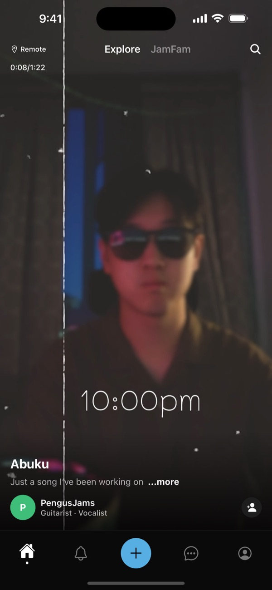
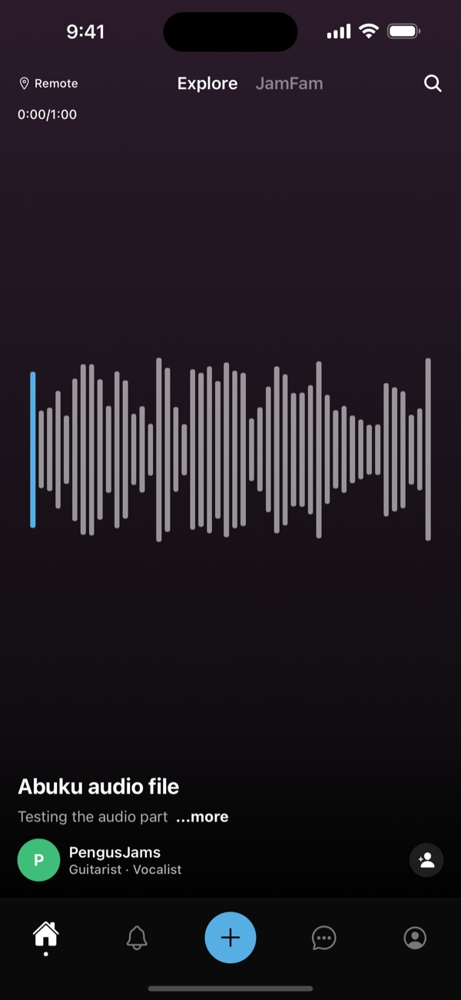
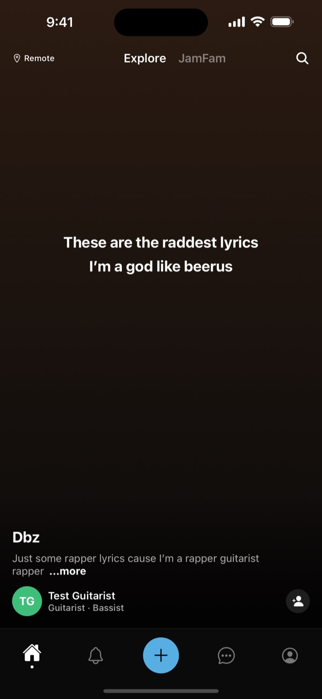
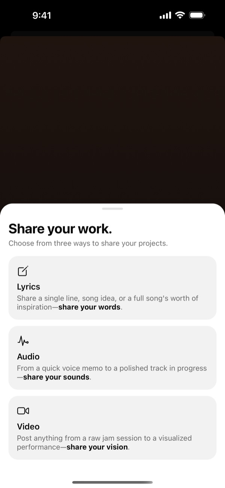
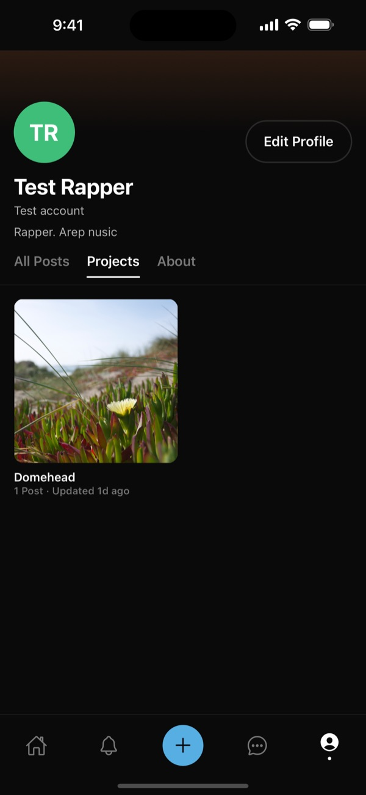

# JamFam-Official

<h4 align="center">Connecting emerging artists with emerging projects</h4>

<p align="center">
   <a aria-label="SDK version" href="https://www.npmjs.com/package/expo" target="_blank">
    
  </a>
</p>

<p align="center">
  <a href="#about">About</a> •
  <a href="#screenshots">Screenshots</a> •
  <a href="#getting-started">Getting Started</a> •
  <a href="#contributors">Contributors</a>
</p>

## About

jamfam is an app that allows emerging artists to make personal connections and build projects with like-minded individuals.

## Screenshots

| Video | Audio | Lyrics |
|---|---|---|
|  |  |  |

| Share your work | Profile |
|---|---|
|  |  |

## Getting Started

```bash
npm install
npx expo start --go
```

Press `i` to open in the iOS Simulator (runs inside Expo Go, so no Xcode build is needed).

## Backend (Firebase)

Accounts, data and media live in Firebase: Auth (email/password), Firestore, and Storage.

1. Create a project at https://console.firebase.google.com (Google Analytics is optional).
2. **Upgrade to the Blaze plan** (required for Storage). At ~60 users it stays within the free tier; set a budget alert under Billing → Budgets & alerts.
3. **Authentication** → Get started → enable **Email/Password**.
4. **Firestore Database** → Create database → production mode → pick a region near your users.
5. **Storage** → Get started → production mode → same region.
6. **Project settings** → General → Your apps → add a **Web app** (`</>`). Copy its config values into `.env` (start from `.env.example`).
7. Deploy the security rules from this repo:
   ```bash
   npx firebase-tools login
   npx firebase-tools use --add
   npx firebase-tools deploy --only firestore:rules,storage
   ```
   Or paste `firestore.rules` and `storage.rules` into the Rules tab of Firestore and Storage in the console.
8. Restart Metro so it picks up `.env`: `npx expo start --go --clear`.

### Data model

| Collection | Doc | Who can write |
|---|---|---|
| `users/{uid}` | Artist profile | That user |
| `projects/{id}` | Folder of posts | Owner |
| `posts/{id}` | Video/audio/lyrics post; `mediaUri`/`coverUri` are Storage download URLs | Author |
| `connectionRequests/{id}` | Request to connect over a post | Sender creates, recipient accepts/declines, either can disconnect |
| `conversations/{uidA_uidB}` | Connected pair + last message; created when a request is accepted, deleted on disconnect | Participants |
| `conversations/{uidA_uidB}/messages/{id}` | Chat message | Participants, as themselves; can't be edited or deleted |

Media is stored at `users/{uid}/posts/{postId}/{media|cover}.{ext}` (100 MB limit per file).

## Contributors

**The OGs**

<a href="https://github.com/joshpeng1999">
    
</a>
<a href="https://github.com/praneershrest">
    
</a>

Tristan Turisno

Henry Liu
